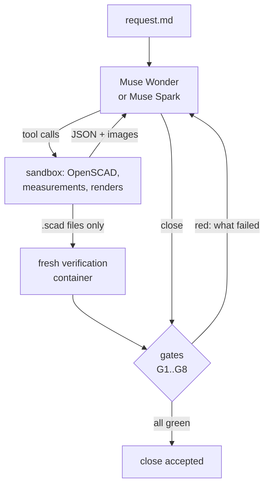

# CADVerify AI

A design agent on Meta's **Muse Wonder** and **Muse Spark** that turns a plain-language request
into printable OpenSCAD parts and assemblies, and cannot say "done" until a deterministic harness
has measured that the geometry is what it claims.

Language models write CAD that looks right in the text and is wrong in the mesh: a hole that
does not go through, a lid that collides with its jar when it turns, an overhang that needs
supports, a wall thinner than the spec. CADVerify makes every claim checkable. The model
declares its intent in the source, the harness measures the exported meshes against it, and the
session closes only when every gate is green and the closing message cites nothing the harness
did not verify.

Built during the [Meta AI Developer Hackathon](https://cerebralvalley.ai/e/meta-ai-developer-hackathon)
(October 27 to November 4, 2026), Indie track.

Every recorded session can be stepped through online, in the
[replay pages](https://juanpighelfi.github.io/cadverify-ai/): the gates at every iteration, each
tool call and what it found, the renders the model saw, and every close, refused or accepted.

## Meta models

All through the Meta Model API Responses endpoint, streamed, with tool calling, reasoning and
vision on the renders the model asks for:

- `muse-wonder-1.0`: the default designer, and the auditor of every closing message (gate G8,
  without tools), whatever model designed. It was chosen by replaying recorded audits with
  planted errors on each model ([how](docs/architecture.md#choosing-the-auditor)).
- `muse-spark-1.3`: the second designer (`--model muse-spark-1.3`), about a quarter of Wonder's
  price per token, though it takes more requests to close
  ([two designers](#two-designers-three-runs-each)). The public demo requests also ran on
  `muse-spark-1.3-contributor`, the same model at a discount in exchange for Meta training on
  what it is sent; the command refuses it for any request outside [requests/](requests/).

## How it works



- **Twelve tools** in a hardened Docker sandbox: write and patch `.scad`, compile, export with a
  mesh report, multi-view sheets and free views with plane cuts from our own renderer,
  printability, an assembly interference and motion check, and the model's own shell and Python.
- **A verifiable spec.** The source echoes what each part must measure (bounds, bodies, through
  holes, support faces, allowed overhangs, details such as a wall thickness or a hole profile)
  and, for an assembly, its press fits, motions, assembly order, the elastic features that may
  flex while it moves (how deep, measured), and whether it prints in place (all its parts at
  once, with a clearance between them).
- **Gates** judged on the harness's own verification, never on the model's tool results:
  compiles clean (G1), closed meshes (G2), assembly with no overlaps (G3), motions and assembly
  order without collisions (G4), printable on the bed without unplanned supports (G5), spec held
  and every final part seen (G7), and an honest close (G8).
- **Rules the harness enforces**: a visual finding must be confirmed with a measurement before
  the source can change; every new mesh comes with its sheet so the model sees what it made;
  a spec quietly moved toward what the mesh measures is flagged and must be told to the user.

Details in [docs/architecture.md](docs/architecture.md).

## Demo

Three requests in [requests/](requests/), each a different kind of mechanism, one session each
with `muse-wonder-1.0`. All three closed with every gate green:

| Request | Requests | USD | Minutes | What the harness caught on the way |
|---|---|---|---|---|
| [Bayonet jar](requests/bayonet_jar.md) ([replay](https://juanpighelfi.github.io/cadverify-ai/results/design/bayonet_jar/20261031T003026Z/replay.html)): a jar and a lid with a quarter-turn lock | 27 | 2.60 | 19 | G4: the detent bump collided with the jar during the quarter turn (an overlap 0.022 mm thick); the model replaced it with a drop-in pocket and told the user why. G8 refused a close with 6 unsupported claims, such as "interior Ø70 × 80 mm", which nothing measured. |
| [Headphone stand](requests/headphone_stand.md) ([replay](https://juanpighelfi.github.io/cadverify-ai/results/design/headphone_stand/20261031T015150Z/replay.html)): three parts that assemble without glue | 17 | 1.31 | 8 | G8 refused a close with 2 unsupported claims (a count of bad edges and an overhang area nobody measured), and one that cited a support face the close check did not know yet (a harness bug, fixed after this session). |
| [Hinge box](requests/hinge_box.md) ([replay](https://juanpighelfi.github.io/cadverify-ai/results/design/hinge_box/20261031T042110Z/replay.html)): a box whose hinge prints in place, already assembled | 40 | 3.10 | 18 | G4: the lid's rear lip hit the box partway through its swing; fixed with a notch. Five spec adjustments were flagged and told in the close. G8 refused a close with 6 unsupported claims, such as "the closed lid is retained at the front". |

Each session is recorded under [results/design/](results/design/): every API request
(`raw/`), every tool call (`tools/`), the sources, renders and images the model saw
(`workspace/`), `session.json`, and `replay.html`, a static page of the whole session, linked
in the table above (it also opens from a local copy of the run directory; `uv run cadverify
replay <run>` rebuilds it).

## Two designers, three runs each

After the demo, each request ran three more times on each designer, on the harness as it is
now (flex in motions and `print_in_place` included), with every close audited by
`muse-wonder-1.0`. Spark ran as `muse-spark-1.3-contributor`, since the requests are public;
"USD Standard" prices the same tokens at the Standard price. Medians per request and model,
from `uv run cadverify table results/bench` (which names the models in full):

| Request | Model | Green | Requests | USD | USD Standard | Minutes | Closes refused |
|---|---|---|---|---|---|---|---|
| bayonet_jar | Spark | 3 of 3 | 42 | 0.32 | 1.38 | 33 | 2 |
| bayonet_jar | Wonder | 3 of 3 | 30 | 2.26 | 2.26 | 15 | 1 |
| headphone_stand | Spark | 3 of 3 | 41 | 0.28 | 1.07 | 22 | 1 |
| headphone_stand | Wonder | 3 of 3 | 51 | 3.14 | 3.14 | 19 | 1 |
| hinge_box | Spark | 2 of 3 | 54 | 0.33 | 2.16 | 46 | 3 |
| hinge_box | Wonder | 3 of 3 | 17 | 3.05 | 3.05 | 17 | 0 |

- Wonder closed 9 of 9 green, Spark 8 of 9. The ninth, a hinge box, ran out of its hour with
  the lid and the pin still overlapping the box at the hinge (G3), after nine attempts to close
  with gates red.
- The nine Spark sessions cost USD 3.00 and the nine Wonder sessions USD 22.94. Spark took more
  requests and more time: at the Standard price its nine would have cost USD 16.55.
- G8 refused 24 closes, in 14 of the 18 sessions (15 in Spark's, 9 in Wonder's). The harness
  refused 14 more because gates were red, 13 of them Spark's.
- Four of the six jars declared their detent as a `flex`. In two it bends 0.2 and 0.8 mm into the
  jar during the turn, as measured; in the other two it never touches the jar, so it holds nothing,
  and G4 lets a flex that never bends pass (see Limitations). Every hinge box declared
  `print_in_place`, and G5 refused it at least once in each: parts 0.01 to 0.25 mm apart that would
  fuse, and the lid printed closed over the box, an undeclared overhang of about 4,350 mm². Each
  green box then declared the lid's ceiling, a zone 48 to 58 mm across, as an allowed overhang (a
  bridge), which G5 accepts with a reason and does not judge (see Limitations).

The sessions are under [results/bench/](results/bench/), with `replay.html` in each, all linked from
the [replay pages](https://juanpighelfi.github.io/cadverify-ai/). The same directory holds what the
round spent before them, all counted by `uv run cadverify spent --results results/bench`: the
capability probe of Spark, the audit replays that chose the auditor (`scripts/audit_replay.py`),
three exploratory Spark sessions on the harness before flex, and three sessions cut when a slow flex
measure was fixed (`aborted/`).

## Quick start

Requirements: Python 3.12, [uv](https://docs.astral.sh/uv/) and Docker with BuildKit. Only
`cadverify design` needs a Meta Model API key; everything else here runs offline.

```sh
uv sync
docker build -t cadverify-sandbox .    # about 1.2 GB, OpenSCAD included
uv run cadverify hostile               # attacks on the real sandbox: each must be contained
uv run cadverify table results/bench   # the bench sessions side by side, per request and model
uv run cadverify summary results/design/bayonet_jar/20261031T003026Z   # one session, per iteration
uv run cadverify replay results/design/bayonet_jar/20261031T003026Z    # rebuilds its replay.html
uv run cadverify index results/design results/bench   # index.html: every replay, linked
```

Open `results/design/bayonet_jar/20261031T003026Z/replay.html` in a browser to step through
that session: the gates at every iteration, each tool call and what it found, the renders the
model saw, and every close, refused or accepted.

With a key, a new session:

```sh
cp .env.example .env    # set MODEL_API_KEY; .env is git-ignored
uv run cadverify design requests/bayonet_jar.md --max-usd 5
uv run cadverify design requests/bayonet_jar.md --model muse-spark-1.3 --max-usd 2
uv run cadverify spent  # USD spent under results/design against the budget
```

The session prints its run directory. If the model asks questions before it starts designing,
they appear in `<run>/questions/NN.md`; write the answer to another file and rename it to
`<run>/questions/NN.answer.md`.

Inside the image, `cadcheck` runs every tool from a shell (`docker run --rm -v "$PWD:/work"
cadverify-sandbox cadcheck --help`).

## Limitations

- A flex is measured for depth, not for strength: whether a detent or a snap can bend that far
  without breaking or creeping is not verified, and a declared flex that never touches passes. The
  assembly order is still swept with rigid parts, so a part that snaps into place on assembly cannot
  pass G4 yet. (Before flex existed, the bayonet jar of the demo traded its detent bump for a
  pocket.)
- G5 checks that every overhang is declared with a reason, not that a declared bridge prints well:
  every green hinge box of the bench prints its lid closed over a ceiling 48 to 58 mm across,
  declared and accepted. A print in place is checked as it prints only when the assembly declares
  `print_in_place`.
- Strength, stability, feel and fit on a particular printer are not measured. The close must
  list them as not verified, and G8 refuses a close that presents them as verified.
- The renders and the spec checks are deterministic, but the design is not: two sessions on the
  same request differ.

## Tests

```sh
uv run pytest && uv run ruff check . && uv run ruff format --check .
docker run --rm -w /app cadverify-sandbox pytest -q -p no:cacheprovider
```

The host tests are offline: the agent tests use a scripted fake model, and
`tests/test_agent_docker.py` and `tests/test_hostile_docker.py` drive the real sandbox when the
image is built. The tests inside the image cover OpenSCAD, the renderer, the cuts and the
measurements.

## License

[MIT](LICENSE)
