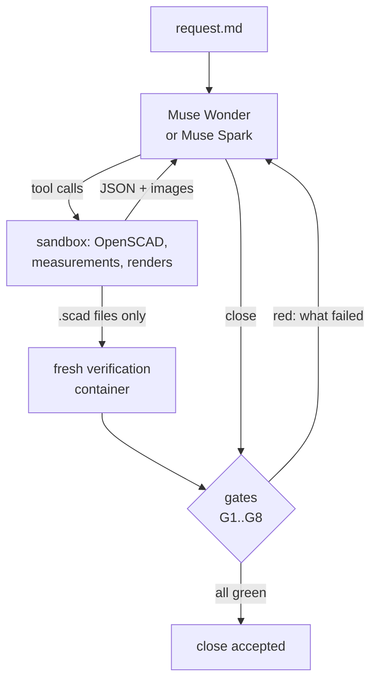
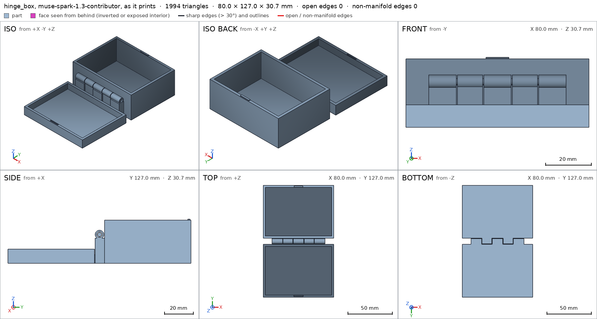

# CADVerify AI

A design agent on Meta's **Muse Wonder** and **Muse Spark** that turns a plain-language request
into printable OpenSCAD parts and assemblies, and cannot say "done" until a deterministic harness
has measured that the geometry is what it claims.

Language models write CAD that looks right in the text and is wrong in the mesh: a hole that
does not go through, a lid that collides with its jar when it turns, an overhang that needs
supports, a wall thinner than the spec. CADVerify makes every claim checkable. The model
declares its intent in the source, the harness measures the exported meshes against it, and the
session closes only when every gate is green and the closing message cites nothing the harness
did not verify.

Built during the [Meta AI Developer Hackathon](https://cerebralvalley.ai/e/meta-ai-developer-hackathon)
(October 27 to November 4, 2026), Indie track.

Every recorded session can be stepped through online, in the
[replay pages](https://juanpighelfi.github.io/cadverify-ai/): the gates at every iteration, each
tool call and what it found, the renders the model saw, and every close, refused or accepted.

After the demo, each round of runs looked for where the harness itself was wrong, and each fix
came with tests: [both designers](#two-designers-three-runs-each) three times on every request,
[the bridges](#bridges-and-the-print-pose) the hinge boxes slipped past, and
[fourteen hard requests](#the-stress-set) written the way a user would, which found five greens
that were wrong.

## Meta models

All through the Meta Model API Responses endpoint, streamed, with tool calling, reasoning and
vision on the renders the model asks for:

- `muse-wonder-1.0`: the default designer, and the auditor of every closing message (gate G8,
  without tools), whatever model designed. It was chosen by replaying recorded audits with
  planted errors on each model ([how](docs/architecture.md#choosing-the-auditor)).
- `muse-spark-1.3`: the second designer (`--model muse-spark-1.3`), about a quarter of Wonder's
  price per token, though it takes more requests to close
  ([two designers](#two-designers-three-runs-each)). The public demo requests also ran on
  `muse-spark-1.3-contributor`, the same model at a discount in exchange for Meta training on
  what it is sent; the command refuses it for any request outside [requests/](requests/).

## How it works



- **Twelve tools** in a hardened Docker sandbox: write and patch `.scad`, compile, export with a
  mesh report, multi-view sheets and free views with plane cuts from our own renderer,
  printability, an assembly interference and motion check, and the model's own shell and Python.
- **A verifiable spec.** The source echoes what each part must measure (bounds, bodies, through
  holes, support faces, allowed overhangs, details such as a wall thickness or a hole profile)
  and, for an assembly, its press fits, motions, assembly order, the elastic features that may
  flex while it moves (how deep, measured), and whether it prints in place (all its parts at
  once, with a clearance between them, as assembled or in a pose of its motions).
- **Gates** judged on the harness's own verification, never on the model's tool results:
  compiles clean (G1), closed meshes (G2), assembly with no overlaps (G3), motions and assembly
  order without collisions (G4), printable on the bed without supports: every overhang declared,
  every bridge 10 mm or shorter and nothing that starts in the air (G5), spec held and every final
  part seen (G7), and an honest close (G8).
- **Rules the harness enforces**: a visual finding must be confirmed with a measurement before
  the source can change; every new mesh comes with its sheet so the model sees what it made;
  a spec quietly moved toward what the mesh measures is flagged and must be told to the user.

Details in [docs/architecture.md](docs/architecture.md).

## Demo

Three requests in [requests/](requests/), each a different kind of mechanism, one session each
with `muse-wonder-1.0`. All three closed with every gate green:

| Request | Requests | USD | Minutes | What the harness caught on the way |
|---|---|---|---|---|
| [Bayonet jar](requests/bayonet_jar.md) ([replay](https://juanpighelfi.github.io/cadverify-ai/results/design/bayonet_jar/20261031T003026Z/replay.html)): a jar and a lid with a quarter-turn lock | 27 | 2.60 | 19 | G4: the detent bump collided with the jar during the quarter turn (an overlap 0.022 mm thick); the model replaced it with a drop-in pocket and told the user why. G8 refused a close with 6 unsupported claims, such as "interior Ø70 × 80 mm", which nothing measured. |
| [Headphone stand](requests/headphone_stand.md) ([replay](https://juanpighelfi.github.io/cadverify-ai/results/design/headphone_stand/20261031T015150Z/replay.html)): three parts that assemble without glue | 17 | 1.31 | 8 | G8 refused a close with 2 unsupported claims (a count of bad edges and an overhang area nobody measured), and one that cited a support face the close check did not know yet (a harness bug, fixed after this session). |
| [Hinge box](requests/hinge_box.md) ([replay](https://juanpighelfi.github.io/cadverify-ai/results/design/hinge_box/20261031T042110Z/replay.html)): a box whose hinge prints in place, already assembled | 40 | 3.10 | 18 | G4: the lid's rear lip hit the box partway through its swing; fixed with a notch. Five spec adjustments were flagged and told in the close. G8 refused a close with 6 unsupported claims, such as "the closed lid is retained at the front". |

The stand and the box passed G5 as it was then. G5 now judges bridges, and on it the stand's
socket ceiling is a 27 mm bridge and flat undersides at the box's hinge knuckles have nothing
under them ([bridges and the print pose](#bridges-and-the-print-pose)).

Each session is recorded under [results/design/](results/design/): every API request
(`raw/`), every tool call (`tools/`), the sources, renders and images the model saw
(`workspace/`), `session.json`, and `replay.html`, a static page of the whole session, linked
in the table above (it also opens from a local copy of the run directory; `uv run cadverify
replay <run>` rebuilds it).

## Two designers, three runs each

After the demo, each request ran three more times on each designer, on the harness as it was
then (flex in motions and `print_in_place` included, bridges not yet), with every close audited by
`muse-wonder-1.0`. Spark ran as `muse-spark-1.3-contributor`, since the requests are public;
"USD Standard" prices the same tokens at the Standard price. Medians per request and model,
from `uv run cadverify table results/bench` (which names the models in full):

| Request | Model | Green | Requests | USD | USD Standard | Minutes | Closes refused |
|---|---|---|---|---|---|---|---|
| bayonet_jar | Spark | 3 of 3 | 42 | 0.32 | 1.38 | 33 | 2 |
| bayonet_jar | Wonder | 3 of 3 | 30 | 2.26 | 2.26 | 15 | 1 |
| headphone_stand | Spark | 3 of 3 | 41 | 0.28 | 1.07 | 22 | 1 |
| headphone_stand | Wonder | 3 of 3 | 51 | 3.14 | 3.14 | 19 | 1 |
| hinge_box | Spark | 2 of 3 | 54 | 0.33 | 2.16 | 46 | 3 |
| hinge_box | Wonder | 3 of 3 | 17 | 3.05 | 3.05 | 17 | 0 |

- Wonder closed 9 of 9 green, Spark 8 of 9. The ninth, a hinge box, ran out of its hour with
  the lid and the pin still overlapping the box at the hinge (G3), after nine attempts to close
  with gates red.
- The nine Spark sessions cost USD 3.00 and the nine Wonder sessions USD 22.94. Spark took more
  requests and more time: at the Standard price its nine would have cost USD 16.55.
- G8 refused 24 closes, in 14 of the 18 sessions (15 in Spark's, 9 in Wonder's). The harness
  refused 14 more because gates were red, 13 of them Spark's.
- Four of the six jars declared their detent as a `flex`. In two it bends 0.2 and 0.8 mm into the
  jar during the turn, as measured; in the other two it never touches the jar, so it holds nothing.
  G4 let a flex that never bends pass then, and refuses it now ([the stress set](#the-stress-set)).
  Every hinge box declared
  `print_in_place`, and G5 refused it at least once in each: parts 0.01 to 0.25 mm apart that would
  fuse, and the lid printed closed over the box, an undeclared overhang of about 4,350 mm². Each
  green box then declared the lid's ceiling, a zone 48 to 58 mm across, as an allowed overhang (a
  bridge), which G5 accepted then without judging it. It judges it now:
  [bridges and the print pose](#bridges-and-the-print-pose).

The sessions are under [results/bench/](results/bench/), with `replay.html` in each, all linked from
the [replay pages](https://juanpighelfi.github.io/cadverify-ai/). The same directory holds what the
round spent before them, all counted by `uv run cadverify spent --results results/bench`: the
capability probe of Spark, the audit replays that chose the auditor (`scripts/audit_replay.py`),
three exploratory Spark sessions on the harness before flex, and three sessions cut when a slow flex
measure was fixed (`aborted/`).

## Bridges and the print pose

The bench left one claim unjudged: every green hinge box printed its lid closed over the box and
declared the lid's ceiling, 48 to 58 mm across, an allowed overhang. G5 now measures the part of
every overhang steeper than 60°, where the A1's slicer adds supports by default, as a bridge,
declared or not ([how](docs/architecture.md#bridges)), and refuses:

- a point of it more than 5 mm, seen from above, from the material under it: a bridge that
  reaches it spans more than 10 mm, the longest a quick FDM design guide gives;
- a part of it with no material under it to start from: it prints in the air;
- a body that starts in the air, with nothing under its lowest layers within 1 mm.

A lid that is closed in the assembly can still print open: an assembly that prints in place may
declare a `print_pose`, a value for each motion it prints in, such as
`["print_pose", [["hinge", 180]]]`. G5 checks the parts placed in that pose and the clearance
between every two, and leaves them together in `print-in-place.stl`.

Every final that closed green, demo and bench, checked again offline on the harness of this round
(G3 to G5; only G5 changed them; the [stress set](#the-stress-set) checks them again):

| Request | Green when recorded | Green on this G5 | What fails |
|---|---|---|---|
| bayonet_jar | 7 | 7 | |
| headphone_stand | 7 | 2 | the ceiling of the hanger's socket, a bridge of 15 to 27 mm |
| hinge_box | 6 | 0 | the lid's ceiling printed closed over the box (36 to 56 mm), lids and pins that start in the air, knuckles whose underside starts in the air |

The hinge box then ran again while this G5 was being built, thirteen sessions under
[results/bridge/](results/bridge/), USD 15.95 in all (`uv run cadverify spent --results
results/bridge`):

| Sessions | G5 judged then | Green in the session | Green now |
|---|---|---|---|
| 3 Spark (`explore/`) | flat ceilings as bridges | 1 of 3 | 0 |
| 3 Wonder, 3 Spark | the same, and no body in the air | 5 of 6 | 0 |
| 1 Wonder, 3 Spark | as now: every face steeper than 60° | 1 of 4 | 0 |

- The first Spark box closed green by printing its lid standing at 100°, hung from its hinge 27 mm
  over the bed ([as it prints](results/bridge/explore/hinge_box/20261102T122416Z/print-in-place.png)):
  its lowest faces slope, so there was no flat ceiling to measure. G5 now refuses a body that
  starts in the air.
- Of the next six, five closed green. Four print the box open, the lid flat on the bed beside it
  ([Wonder's first](results/bridge/hinge_box/20261102T132939Z/print-in-place.png)). The fifth
  stood its lid up again, on a hinge held by a post from the bed, and declared the lid's lower
  edge, 80° from vertical and 10 mm out from the hinge, an allowed overhang
  ([as it prints](results/bridge/hinge_box/20261102T132944Z/print-in-place.png)). G5 now measures
  every face steeper than 60°, and on that the four open boxes fail too: the underside of each
  hinge knuckle starts in the air, beside the wall that holds it.
- Of the last four, one closed green: Spark's third, USD 0.46 in 56 minutes. It prints the box
  open, each knuckle on a web from the bed and the pin 0.425 mm over the floor of its bores.
  Checking it found a hole in G4: the box's catch was declared a press fit, and G4 left
  press-fit pairs out of its sweeps, so it never measured the lid against the box. The declared
  assembly order brought the lid in moving up, through the floor of the box. G4 now sweeps a
  press fit as a fit ([how](docs/architecture.md#the-verifiable-spec)), and on it this box failed
  on that direction alone: reversed by hand, offline, it passed G3 to G5 as they were then. The
  [stress set](#the-stress-set) found two more: its pin is free to slide out along its axis, and
  its catch never touches the box. Wonder's box passed G5
  from its twelfth iteration
  ([as it prints](results/bridge/hinge_box/20261102T153656Z/print-in-place.png)) and spent its
  USD 4 with the lid's assembly order red; the other two Spark sessions ran out of their hour,
  each reasoning to the 64k-token output limit twice.

Spark's last box as it prints, G5 green: the box and its lid open on the bed, each hinge knuckle
on a web from the bed:



## The stress set

To find where the harness was wrong, fourteen new requests went in the way a user would write
them ([requests/](requests/)), each picked to be hard for it:

- six it could already express: a print-in-place flexi bracelet, a pill box with a lid that
  clicks at each day, a battery box with a sliding cover, desk drawers that stop, a spool holder
  on a 608 bearing, a ratchet;
- five it could not: a screw-top jar, a planetary gearbox, a ball joint, a gimbal, a bag clip with
  a living hinge;
- three that must fit a standard: a Gridfinity bin, a Raspberry Pi 4 case, an M3 knob.

Each ran once on Spark (`muse-spark-1.3-contributor`, USD 1 cap) on the harness as it was then
(61b0c46): 11 closed green and 3 ran out of their time, USD 2.76 in all. Five of the greens were
wrong, and so was what stopped two of the others:

| Request | What the session showed | What was wrong | What the harness checks now |
|---|---|---|---|
| gimbal | rings that swing 0-360° | the pivots lie in grooves open at the top: the rings lift out | each part printed in place must be held by the others |
| flexi_bracelet | links that bend ±30° | the links hang in open hooks: they lift apart | the same |
| living_hinge_clip | "closing slide 0-20 mm sweeps free" | the motion moved the whole clip: nothing moved against anything | a motion must move a part against another |
| battery_box | a cover latch that flexes | the latch's flex measured 0.0 mm: it never touches | a flex must touch along its motion |
| pi4_case | standoffs that line up with the board | the board was the model's own block: the standoffs sat 10 mm off a real Pi 4's holes | standard parts the harness draws itself |
| planetary_gearbox | ran out of time | one motion turned sun, planets and ring together, the only way the spec had | a motion may drive other parts at a ratio |
| screw_jar | ran out of time | the thread was declared as a turn and a slide, each with a flex | a screw motion |

The other greens held up. Two of them, the ratchet and the drawers, claimed an end stop the
harness could not measure, and the pill box ran out of time because each check of its 360° lid
turn took over 15 minutes. What changed, each with tests
([how](docs/architecture.md#the-verifiable-spec)):

- **Held.** Each part of an assembly printed in place must be held by the others: G3 moves it
  straight along the six axes and then the diagonals, and refuses one that comes off. An
  assembly that is put together may list the parts that must stay on in `held`.
- **Motions that move something.** A motion whose parts all move together is refused. A `screw`
  motion turns and advances by its pitch; `drives` turns or slides other parts at a ratio (a
  gear train); `stops` names the ends where something must be in the way, and G4 moves on past
  each end, 2 mm for its fastest point, to find it.
- **Flex that bends.** A flex must overlap what it rides over somewhere along its motion, and the
  assembly order may declare one, for a part that snaps in as it comes in. Its depth is measured
  about 50 times faster.
- **Standard parts.** `standard:pi4_board` (and `bearing_608`, `aa_cell`, `m3_nut`) is a part the
  harness draws from its datasheet, in `cadverify_parts.scad`; an instance of it must be that
  part, moved, so a case has to fit the real board.

Then each request ran again on Spark, and the five that taught most also on Wonder (USD 4 cap),
on the harness as it changed, USD 13.18 for 18 sessions:

| Request | Spark, USD | Wonder, USD | What it showed |
|---|---|---|---|
| planetary_gearbox | API&nbsp;error | green,&nbsp;2.08 | the carrier turns the planets about the sun and drives the sun at 4 and each planet at -3 on its own axis, for a fixed 45-tooth ring |
| screw_jar | green,&nbsp;0.32 | green,&nbsp;1.28 | a `screw` motion and the lid `held`; Wonder's stops at closed, against its thread |
| gimbal | green,&nbsp;0.23 | green,&nbsp;1.63 | pins in closed sockets, every part held; Wonder's prints standing on a plinth |
| ball_joint | green,&nbsp;0.24 | | the socket snaps over the ball as it goes in (0.49 mm of its 1 mm flex) |
| flexi_bracelet | green,&nbsp;0.36 | | pins capped at both ends, every link held; one joint of three declared as a motion |
| pill_box | green,&nbsp;0.25 | stopped | its close left the seven clicks unverified: nothing could say where they are |
| ratchet | green,&nbsp;0.31 | | told its flex never touched, the model removed it: the pawl touches nothing, and no stop |
| battery_box | green,&nbsp;0.43 | | two `standard:aa_cell`; the cover's catch rides 0.8 mm over the wall as it slides |
| spool_holder | green,&nbsp;0.25 | | `standard:bearing_608` pressed into its seat |
| desk_drawers | green,&nbsp;0.30 | | both stops measured: the frame stops each drawer 1.25 mm past closed and 0.25 mm past open |
| pi4_case | green,&nbsp;0.45 | green,&nbsp;4.15 | `standard:pi4_board` on standoffs under its four holes |
| living_hinge_clip | ran&nbsp;out&nbsp;of&nbsp;time | | one piece bent at a living hinge, drawn as two parts and a turn |
| m3_knob | green,&nbsp;0.29 | | `standard:m3_nut` in its pocket |
| gridfinity_bin | green,&nbsp;0.06 | | the foot profile from the published spec, which nothing checks |

What it found, each fixed with tests:

- **A false red.** The bound on a flex's depth could not close across a wide flat overlap, and
  refused both pill box lids: Spark's snap, 0.6 mm into its 0.8 mm flex, as "may go 0.89 mm".
  It is exact there now. Wonder's pill box was stopped on it, after USD 0.70, and ran again.
- **Clicks.** The pill box could not say where its lid clicks. A motion's `rests` are the values
  where a detent holds it: its flex is free there, and rides over something between two rests.
- **A green that holds nothing.** The ratchet's every claim was true, and its pawl touched
  nothing. The auditor now reads the request, and refuses a close that leaves unmeasured
  something the request asks for and a declaration would have measured: a stop, rests, a flex, a
  held part, a printed thread, gears, a print in place, a standard part
  ([how, and its replays](docs/architecture.md#the-auditor-reads-the-request), USD 5.75).
- **An auditor that asked too much.** It asked the knob's set screw to hold the knob on, and the
  model drew the screw as a part in the knob's way and listed the knob as held; and it asked the
  clip, one part that bends, to be printed in place. It leaves out friction and a part that
  bends now.
- **The end in sight, misjudged.** The clip, told it had one request left and to close without
  tools, closed four times in a row, refused each time for a view it had not seen: the note went
  out at every request the estimate found one left, in six sessions, up to 14 times. And the
  ratchet of the next round was told at its first request that about 10 were left, as were 18
  other sessions at their first or second: one long first request made the average. The last
  note goes out once now, and the estimate waits for half the time or the cost to be used.
- **More.** A first assembly step that placed every part together, which only a print in place
  may; a chained request that failed four times with a server error, now resent whole; the
  standard parts off the path of the model's own shell; a tool call with a wrong argument name,
  now told the names the tool takes.

On the final harness, the pill box ran again on both designers, and the ratchet, the clip, the
knob and the gearbox on Spark, USD 4.16 in all:

| Request | Spark, USD | Wonder, USD | What it showed |
|---|---|---|---|
| pill_box | green,&nbsp;0.19 | green,&nbsp;2.75 | the lid rests at each of the seven days, free there and riding over what it presses on between them (0.8 mm of a 1 mm flex on Spark, 0.4 of 0.5 on Wonder), and snaps on as it goes in; Wonder's first detent rode over nothing between any two days, and G4 said so for each |
| ratchet | green,&nbsp;0.44 | | one way, the pawl rides over a tooth (0.6 mm of 1 mm); the other way, the wheel stops 8° in, against the pawl |
| living_hinge_clip | green,&nbsp;0.30 | | the auditor asked for the stop on the bag and the rest the latch holds at, not a print in place; the close says the two arms are one piece at the film, which nothing measures |
| m3_knob | green,&nbsp;0.21 | | no set screw drawn as a part, and no early note of the end |
| planetary_gearbox | green,&nbsp;0.27 | | herringbone gears that hold each other in, printed in place: the carrier turns the planets about the sun and drives the sun at 3 and each planet at -3 on its own axis, for a fixed 54-tooth ring |

Every final ever recorded, checked again offline on the final harness (G3 to G5):

| Sessions | Green when recorded | Green now | What fails |
|---|--:|--:|---|
| demo | 3 | 1 | the stand's socket ceiling, a bridge; the hinge box's knuckles |
| bench | 17 | 6 | two jars whose flex never touches the jar; four stands' socket ceilings; every hinge box on G5, and in three of them the pin, free to slide out along its axis |
| bridge | 7 | 0 | in six, the pin, free to slide out along its axis; all but the last on G5; the last one's lid, brought in through the floor of the box, and its catch, which never touches |
| stress, first round | 11 | 7 | the gimbal, the bracelet, the clip and the battery box above; the Pi case still passes G3 to G5, since its board is its own, and only the auditor would ask for the standard one now |
| stress, second round | 16 | 16 | |
| stress, final harness | 6 | 6 | |

## Quick start

Requirements: Python 3.12, [uv](https://docs.astral.sh/uv/) and Docker with BuildKit. Only
`cadverify design` needs a Meta Model API key; everything else here runs offline.

```sh
uv sync
docker build -t cadverify-sandbox .    # about 1.2 GB, OpenSCAD included
uv run cadverify hostile               # attacks on the real sandbox: each must be contained
uv run cadverify table results/bench   # the bench sessions side by side, per request and model
uv run cadverify summary results/design/bayonet_jar/20261031T003026Z   # one session, per iteration
uv run cadverify replay results/design/bayonet_jar/20261031T003026Z    # rebuilds its replay.html
uv run cadverify index results/design results/bench results/bridge results/bridge/explore
```

Open `results/design/bayonet_jar/20261031T003026Z/replay.html` in a browser to step through
that session: the gates at every iteration, each tool call and what it found, the renders the
model saw, and every close, refused or accepted.

With a key, a new session:

```sh
cp .env.example .env    # set MODEL_API_KEY; .env is git-ignored
uv run cadverify design requests/bayonet_jar.md --max-usd 5
uv run cadverify design requests/bayonet_jar.md --model muse-spark-1.3 --max-usd 2
uv run cadverify spent  # USD spent under results/design against the budget
```

The session prints its run directory. If the model asks questions before it starts designing,
they appear in `<run>/questions/NN.md`; write the answer to another file and rename it to
`<run>/questions/NN.answer.md`.

Inside the image, `cadcheck` runs every tool from a shell (`docker run --rm -v "$PWD:/work"
cadverify-sandbox cadcheck --help`).

## Limitations

- A flex is measured for depth, not for strength: whether a detent or a snap can bend that far
  without breaking or creeping is not verified. (Before flex existed, the bayonet jar of the demo
  traded its detent bump for a pocket.)
- Held is checked by moving each part in a straight line, along the axes and the diagonals: a
  part that comes off only by turning or along a curve counts as held. Motions are checked as
  declared: a way a part can move that no motion declares is not swept, a gear train turns only
  at the ratios its `drives` declare, and a stop is looked for within 2 mm past a declared end.
- A single part that bends, such as a living hinge, cannot be declared: a session draws it as two
  parts and a turn, and the film that bends is not measured.
- The standard parts are four: a Raspberry Pi 4 (without its microSD slot and anything under the
  board, which its mechanical drawing does not give), a 608 bearing, an AA cell and an M3 nut.
  A design that draws its own version of any other bought part is checked only against itself,
  and a standard part is checked for collisions and contact: a board resting on standoffs touches
  them wherever they are, so whether each standoff is under its hole is not measured unless a
  screw through the hole is placed too.
- G5 measures a bridge by a lower bound: the farthest point of an overhang's part steeper than 60°
  from the material under it, doubled. It does not tell a part held on one side from one held on
  two, it leaves out strips narrower than 0.8 mm, it lets material up to 1 mm under a face hold it
  the way a support would, and its 10 mm limit comes from a design guide, not from prints on an
  A1; how much a bridge sags is not measured. A declared slope between 45° and 60° is still
  accepted with its reason. A print in place is checked as it prints only when the assembly
  declares `print_in_place`, and its clearance is one number for every direction: a gap of 0.2 mm
  under a part passes like one beside it, though at 0.2 mm layers it may fuse.
- No recorded hinge box passes the harness as it is now. The last one prints its pin 0.425 mm
  over the floor of its bores, which G5 takes as holding it the way a support would: whether it
  then breaks free is not measured.
- Strength, stability, feel and fit on a particular printer are not measured. The close must
  list them as not verified, and G8 refuses a close that presents them as verified.
- The renders and the spec checks are deterministic, but the design is not: two sessions on the
  same request differ.

## Tests

```sh
uv run pytest && uv run ruff check . && uv run ruff format --check .
docker run --rm -w /app cadverify-sandbox pytest -q -p no:cacheprovider
```

The host tests are offline: the agent tests use a scripted fake model, and
`tests/test_agent_docker.py` and `tests/test_hostile_docker.py` drive the real sandbox when the
image is built. The tests inside the image cover OpenSCAD, the renderer, the cuts and the
measurements.

## License

[MIT](LICENSE)
