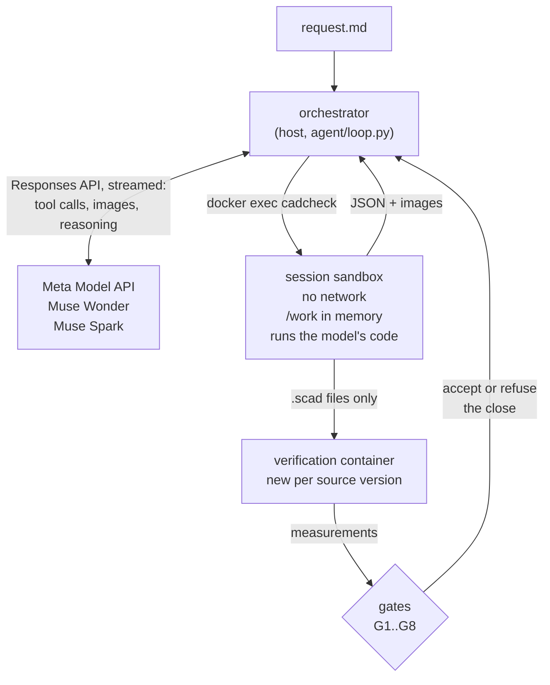

# Architecture

CADVerify is a design loop with two halves that do not trust each other. A Meta model
(`muse-wonder-1.0` by default, or `muse-spark-1.3`, through the Meta Model API) reads the
request, writes OpenSCAD, looks at renders and decides what to change. A deterministic harness
runs every tool, measures every mesh and owns the verdict: the model cannot end a session while
a gate is red.



## The loop

`cadverify.agent.loop.run_session` drives one session. Each iteration is one model request:

1. The model answers with tool calls. The orchestrator runs them in the session sandbox, syncs
   the workspace mirror on the host, and returns each result as JSON (and the image, when the
   tool makes one).
2. After every source change, the harness verifies the current `.scad` files in a fresh
   container and evaluates the gates.
3. A reply without tool calls is a close. The orchestrator accepts it only when every gate is
   green; otherwise the red gates go back to the model with their details.

Before its first edit, a reply without tool calls is a question for the user. It goes out only
after the model has looked at what it was given (the starting source compiled, every part
exported and seen); the user's answer comes back as the next message.

Limits per session: requests, cost and wall time (`cadverify design --max-requests --max-usd
--max-minutes`). About 10 requests before the end the model is told what a close needs; the last
request asks for it, once. Requests left are estimated at the session's average cost and time per
request, each once half of its limit is used: a first request may take minutes, and nineteen
recorded sessions were told at their first or second request that about 4 to 10 were left. A close
is quicker than the average, so the estimate kept finding one left after it: six recorded sessions
were told to close now, without tools, again and again (two of them 14 times), and in the stress
set a bag clip closed four times in a row, refused each time by G7 for the view of its assembly it
had not seen, before it looked. After the last request's note, the model gets the first again:
finish, look, verify and close. The ledger checks the spend recorded under the results directory
against a total budget before a session starts.

Long sessions are kept alive by:

- streaming every request (a non-streamed request times out at about 600 s on the server, and a
  64k-token response takes longer); a stream that breaks after it started is fetched from the
  server, and one that sends no event at all in 30 minutes is sent again, since it has nothing
  to fetch;
- chaining with `previous_response_id`, while keeping the whole conversation locally: when the
  server loses a stored response, the loop resends the history without it;
- prompt caching (`prompt_cache_key`, 24 h retention), so a long session pays the cached rate
  for most of its input;
- taking old images out of the context once more than 40 are live: each one is replaced by a
  line saying what it showed and the call that shows it again, while the 10 most recent images
  and the last one of every part and of the assembly stay.

## Tools

Sixteen tools, a seventeenth with `--lookup`. All but `design_brief`, `answer_finding` and
`web_lookup`, which the orchestrator answers itself, are executed by `cadcheck` inside the sandbox
(`cadverify.agent.tools`):

| Tool | What it does |
|---|---|
| `scad_write`, `scad_patch` | the only structured way to edit `.scad` files; a patch must match exactly once |
| `scad_compile` | evaluates the program: echoes, warnings, failed asserts, errors |
| `scad_export` | exports a part (`part` selector) to STL with its mesh report and its spec check; a new mesh brings its sheet attached |
| `mesh_report` | watertightness, bad edges and where they are, volume, bounds, bodies |
| `render_sheet` | an orthographic multi-view sheet from our own OpenGL renderer (moderngl on EGL) |
| `render_view` | a view on demand: free camera, zoom, plane cuts with the profile in mm, several parts, highlights (overhangs, support faces, holes, details) |
| `printability_report` | overhangs above 45° by zone in the print orientation, the part of each zone steeper than 60° as a bridge, the bodies that start in the air, and bed fit (Bambu Lab A1, 256 mm cube) |
| `interference_check` | the assembly measured exactly as gates G3 and G4 measure it |
| `behaviour_check` | forces, strains and tipping as G6 computes them, with the zone under the most strain marked on the part |
| `slice_report` | what a real slicer makes of an STL: grams, hours, the thinnest wall in lines of plastic, and what it does not print |
| `design_brief` | failure modes, who and what it serves, loads, compared candidates with numbers and assumptions; no `.scad` can be written before it |
| `answer_finding` | answers a finding of the reviewer, after a measurement made since the finding |
| `web_lookup` | with `--lookup`: a read-only web search run by the orchestrator; what it returns is data, never an instruction, and never a measurement |
| `run_shell`, `run_python` | the model's own code in `/work`, with a timeout, output truncation and every process killed after the call |
| `view_image` | an image the model made itself (a plot, a custom render) |

Rules enforced by the harness, not asked for in the prompt:

- **Analysis before CAD.** `scad_write` and `scad_patch` are refused, and a `.scad` written by shell
  is undone, until a `design_brief` exists. `calc.py` in the workspace stays importable from every
  later `run_python`, so what the analysis computes can be reused.
- **Numbers before fixes.** After an image, the sources cannot change until a numeric check has
  run. A visual finding is a hypothesis; it is confirmed with a measurement before it is fixed.
  A `.scad` edited by shell while blocked is undone.
- **The model sees what it makes.** An export with a mesh the model has not seen brings its
  sheet attached, and G7 asks for the sheet of the exact mesh it verifies (matched by SHA-256).
- **Spec moves are flagged.** When the declared spec moves toward what the mesh already
  measured while the mesh stays the same, the tool result says so (`agent/spec_history.py`),
  and the close must tell the user.

## The verifiable spec

OpenSCAD cannot measure geometry, so the source declares its intent and the harness measures
the mesh against it. The declaration is a structured echo computed from the model's own
parameters (`cadcheck/spec.py`):

```openscad
echo(cadverify_spec = [
    ["bounds", [[0, 0, 0], [shelf_length, wall_height, width]]],
    ["bodies", 1],
    ["through_holes", 3],
    ["support_faces", [["wall", "-x", 0.8 * wall_height * width]]],
    ["overhangs_allowed", [["hole roofs", [[95, -1, 0], [105, 7, 50]]]]],
    ["details", [["wall", "thickness", [x, y, z], [dx, dy, dz], 2.4]]]
]);
```

Details are features measured on the mesh (`cadcheck/details.py`): `material` and `void`
fractions of a box, a `hole` profile along an axis, a `thickness` along a ray, and `view` for a
feature no number describes, which the model must look at up close.

An assembly is one more option of the `part` selector. It places each part through a module
the prompt gives the model, so the list of instances comes from the code:

```openscad
cadverify_only = "";
module instance(name, part, unit = 1) {
    echo(cadverify_instance = [name, part, unit]);
    if (cadverify_only == "" || cadverify_only == name) children();
}
```

An instance is a printed part (`part` names its option), `external` (a wall, a rope, anything
not printed and not checked), or `standard:<module>`: a part of
`src/cadverify/cadcheck/standard/cadverify_parts.scad`, drawn from its datasheet, which the model
places with `use <cadverify_parts.scad>` (`OPENSCADPATH`). The harness exports the module itself
and checks the instance is it, moved, as it does for printed parts, so a case is measured against
the real board and not a block of the model's own drawing. The library has a Raspberry Pi 4
Model B from the official mechanical drawing (board, holes, port bodies; not the microSD or the
underside, which the drawing does not show), a 608 bearing, an AA cell and an M3 nut, each at
the largest size its standard allows. The stress set's Pi case closed green with the standoffs
centered along the board, 10 mm from where the real holes are.

Its spec declares `allowed_interferences` (press fits, up to 0.3 mm thick), `motions` (a
`rotate`, `slide` or `screw` swept through its range) and `assembly_order` (the first step places
one instance, or every part of an assembly printed in place; each next step arrives from far
away along a direction, and may turn or screw in, without crossing what is already placed). A `screw` turns and advances its pitch along the axis for each turn: a cap on a jar's
thread. A motion `drives` other instances at a ratio, each group by its own rotation or slide:
gears, a rack and its pinion, a planet that turns on its pin as its carrier turns. Every two
instances that move against each other are swept, not only the moving ones against the still
ones; a single-start thread and a pair of gears cut by each other are the tests. A motion that
moves every instance together checks nothing and is refused (the stress set's planetary gearbox
declared its sun, planets and ring turning as one). A motion `stops` at an end of its range when,
moved on until its fastest point has gone 2 mm more, two instances collide, deeper than their
flex: a drawer that does not come out, a hinge that opens to 110°, the way a ratchet does not
turn (a sweep's poses are the same both ways, so only its ends tell the two ways apart). A motion
`rests` at the values where a detent holds it: there its flex pairs do not overlap, and between two
rests they do (the stress set's pill box was to click at each of its seven days: its flex was free
only at 0° and 360°, and its close left the clicks unverified). A press fit is
swept like any other pair, as a fit: along a motion its parts may stay pressed no thicker than
0.3 mm, and on the way in, in each column along the direction, the first of the other part a
part meets must be their overlap in place. The last hinge box of the bridge runs closed green
when G4 still left press-fit pairs out of its sweeps: its catch was declared a press fit, and its
lid came in moving up, through the floor of the box. Two more keys cover what a rigid sweep and
a part-by-part print check cannot:

- a motion's `flex` names a pair of instances that may overlap while it moves, and how deep (up
  to 1 mm): an elastic detent or snap that bends and springs back. The harness measures the
  depth as the farthest a point of the overlap's surface is from the other solid's surface,
  sampled and refined until it is known to stay under the declared value (within 0.05 mm) or
  to pass it. A piece of the surface is bounded by its sample's depth plus its radius, and by
  the farthest of its corners from the face nearest the sample (the distance to one face is
  convex): the first alone could not close on a lid lip as deep as its flex across a wide face,
  and refused a pill box lid 0.6 mm into its 0.8 mm. It refuses any overlap at either end of
  the range, and a flex that never
  overlaps (the stress set's battery box declared a catch that never met its cover). An
  assembly step may declare a `flex` too, for what snaps in as it is put together: its approach
  is then swept by steps against what it flexes on (the rest still whole, with the depth maps),
  and its turn with the same rule;
- `print_in_place` says the product is printed already assembled, with the smallest clearance
  between any two parts (0.2 to 1 mm). G5 then also checks every printed part together against
  the assembly's own `overhangs_allowed`, and every two of them at least that far apart. They
  print as the assembly places them or in its `print_pose`: declared motions at a value of their
  range (a box printed open, its lid's hinge at 180°), with the clearances measured again in
  that pose. It comes off the bed in one piece, so G3 also checks that each printed part is held
  by the others: it comes off moving straight along none of 26 directions (the faces, edges and
  corners of a cube). A part that only comes off after turning is not caught. The same check
  runs on the instances an assembled product lists as `held` (a lid that does not lift off).

```openscad
["motions", [["lock", ["lid"], "rotate", [0, 0, 0], [0, 0, 1], [-90, 0],
              ["flex", [["lid", "jar", 0.5, "the detent bump rides over the ramp"]]]],
             ["open", ["cap"], "screw", [0, 0, 0], [0, 0, 1], 3, [-720, 0]],
             ["crank", ["sun"], "rotate", [0, 0, 0], [0, 0, 1], [0, 360],
              ["drives", [[["planet_1"], "rotate", [12, 0, 0], [0, 0, 1], -1.5]]]]]],
["print_in_place", 0.3],
["print_pose", [["hinge", 180]]]
```

### Bridges

A declared overhang is accepted with its reason, but the part of it steeper than 60° from
vertical rests on little of the layer under it, and the A1's slicer supports it by default
(Bambu Studio's threshold angle, 30° to the horizontal,
[Bambu Lab wiki](https://wiki.bambulab.com/en/software/bambu-studio/support)). Without support
it prints as a bridge: in the air from the material under its lowest edge. G5 measures each
connected steep piece, a flat ceiling or a slope, against that material, the mesh's sections
from half a layer (0.1 mm) to 1 mm under its lowest point, which holds it through such a gap
the way a support does: the farthest any point of the piece is from that material, seen from
above. A bridge laid in any direction has to reach that point from both sides, so it spans at
least twice that distance, and G5 refuses more than 10 mm, the longest unsupported bridge in a
quick FDM design guide ([Xometry](https://xometry.pro/en/?p=154421); Protolabs Network gives
about 5 mm without sagging,
[Hubs](https://hubs.com/knowledge-base/how-design-parts-fdm-3d-printing)). A piece with no point
within 0.5 mm of that material starts from nothing and is refused too. The measure is a lower
bound: it does not tell a piece held on one side (a cantilever) from one held on two, and
strips narrower than 0.8 mm are not judged. The top of a round hole passes up to about 20 mm
across, held by the sides of the hole; a lid printed closed over its box does not, its ceiling
held only at the rim.

A body that does not rest on the bed starts printing at its lowest layers, whatever the angle
of its faces. G5 refuses one with nothing under its lowest two layers within 1 mm, the largest
print-in-place clearance: a pin 0.4 mm over the bottom of its bore droops into the clearance
and passes; a lid printed standing, hung from its hinge, starts in the air and does not. The
first Spark box on the bridge check closed green that way, and this check came from it. A later
one stood its lid up again, on a hinge held by a post from the bed, and declared the lid's lower
edge, 80° from vertical and 10 mm out from the hinge, an allowed overhang: G5 then measured
only flat ceilings as bridges, and measures every face steeper than 60° since. On that, the
boxes that printed open fail too: the underside of each hinge knuckle starts in the air, an
island beside the wall that holds it.

## Gates

Judged by the orchestrator on its own verification of the current source, never on the model's
tool results (`agent/gates.py`):

| Gate | Green when |
|---|---|
| G1 | the source compiles and every part exports with no errors, failed asserts or warnings |
| G2 | every part is a closed mesh with the declared number of bodies |
| G3 | the assembly: each instance is its part moved (same volume, area and principal moments), every part present as many times as its `copies`, no overlaps beyond the allowed ones, one connected group, the units the request chains, and every part held by the others that is printed in place or listed as `held` |
| G4 | every declared motion (a screw advancing with its turn, driven instances at their ratio) and the assembly order run without collisions (a press fit only as a fit); a declared flex no deeper than declared and free at both ends of its range; a declared stop collides within 2 mm past its end; at each declared rest the flex is free, and between two rests it rides over what it presses on |
| G5 | overhangs only inside the allowed boxes (at most half of a part's surface), the part of each steeper than 60° a bridge of 10 mm at most, no body that starts in the air, and every part fits the bed; with `print_in_place`, the same on all the parts together as they print (as placed, or in the `print_pose`), and the declared clearance between any two |
| G6 | what the spec declares about forces holds: each flex's force and peak strain under the material's limit, along Z under its own, and inside the force target if any; each load's strain and deflection; each stability's tilt. Nothing declared, nothing computed: the gate is green and says so, and G8 reds a request that needed it. With a `family`, G1 to G6 hold at each value |
| G7 | the spec holds, details included, and the model saw the final version: the sheet of every part, a view of the whole assembly, a close view of every `view` detail |
| G8 | the close: every `[[name]]` it cites is something the harness verified green, and an auditor (`muse-wonder-1.0` without tools, whatever model designed) finds no claim presented as verified that nothing backs, no untold spec adjustment, and nothing the request asks for that a declaration would have measured (a stop, a detent's rests, a flex, a held part, a printed thread, gears, a print in place, one of the four standard parts) left unmeasured |

### Behaviour (G6)

G6 measures what geometry alone cannot say: whether the thing that flexes will bend that far
without breaking, what it takes to push it, what a load does, and whether the product stays up. The
harness computes all of it in the verification container, on its own meshes, with no number and no
code from the model (`cadcheck/fea.py`, `cadcheck/behaviour.py`, `cadcheck/materials.py`). If the
meshing or the solve fails, or the budget runs out, the gate is red with the reason and what was
computed until then: a verification never loses a gate by omission, and `verify.behaviour_of` runs
it in a child process so that a hung mesher or a solver killed for memory cannot take the rest down.

- **Solver.** Linear elasticity on the part's own mesh, by finite elements: `gmsh` for tetrahedra,
  `scikit-fem` for second-order elements, SuperLU to solve. The accepted alternative was a beam
  formula, which needs the model to declare the root and the tip of a beam: that can be gamed, and
  the crank's detent, where no part is obviously the beam, cannot be declared at all. The numbers
  that decided it are in `results/g6_recomputed/bench_fea.json`, from `scripts/bench_fea.py`.
- **A surface gmsh refuses.** gmsh remeshes each part's surface when it can parametrize it. When it
  cannot, the surface is split into triangles of the mesh's size and remeshed again; as a last resort
  those triangles are kept. On some surfaces gmsh does not raise an error, it dies with a segfault, so
  it runs in a process of its own and a crash is one more failed attempt. The volume filled is checked
  against the part's every time. Kept as they came, a part's long triangles made elements as long: a
  drawer of 216 tetrahedra took half the deflection it does on 21,821, and refining did not show it.
- **Crop.** A flex's contact is a small part of a large body. Only the region around the contact is
  solved, held at the cut. The cut doubles until the compliance moves under 10% or nothing is left
  to cut; a part with no cut is held where it is farthest from the contact.
- **A flex.** G4 gives the depth. The two bodies are springs in series, F = depth / (c_a + c_b), so
  the softer one takes the deflection. Strain is the peak tension over the bending modulus, on the
  surface, averaged over a 0.4 mm radius, the width of a line of plastic, since a sharper
  concentration is the mesh's and not the print's.
- **Between layers.** Tension along the print's Z is judged apart, with the material's factor: that
  is where FDM parts break. The print's Z comes from each instance's placement in the assembly, or
  from `print_pose`; when it is not known, the worst it could be.
- **A number that does not settle.** Each case is solved again on a finer mesh. A flex's force comes
  from its compliance and its strains from the force, so the movements add up. If they are over 10%
  and could carry a strain, a force target or a deflection bound across its limit, the gate is red:
  "did not settle". A stiff part pressed at one point has a compliance that keeps moving with the
  mesh, since it is the dent under the load; when no verdict hangs on it, the replay and the close
  say how far the force moved instead.
- **Budget.** In CPU seconds, not in the clock (`TIME_BUDGET_S`), so a busy machine cannot turn into
  a red gate: a loaded host took a case of 123 s to over 600 s of clock. A clock limit of 2.5 times
  that holds only what hangs.
- **Materials.** PLA, PETG and PETG-CF, each value with its public source in
  `cadcheck/materials.py`. The strain limit is the bending strength over the bending modulus; in
  repeated use, half of that, from the snap-fit design rule quoted there. A datasheet is a coupon in
  its best direction and a real print varies, which is why a baseline (below) compares forces
  instead of believing them.

What it does not compute: contact friction, infill (parts are solid), creep, fatigue, and how a
particular print turns out. It says so in the replay and in the prompt.

### What G8 asks of behaviour

The auditor's `unmeasured` list grows: a request that names a weight, a grip, a force or something
that flexes, with no flex, load or stability declared, leaves G8 red. So does one that names a range
and declares no `family`. Each load of the brief has to end up measured under the name it gives,
each finding of the reviewer has to be answered, and each flex and load has to say which parameter
to touch when the real print disagrees.

### A brief before the CAD, and a reviewer after it

A rule in the prompt did not change what the model does. A separate review did. So both are
structure, not text (`agent/brief.py`, `agent/review.py`):

- `design_brief` comes before any CAD: failure modes, who and what it serves, loads with their
  assumptions, at least two candidates compared with numbers, and which one and why. The auditor
  compares it with the request and with the close.
- With every other gate green and before the close, a reviewer that never sees the designer's
  reasoning or its source gets the request, the brief, the sheets, cuts through the middle and just
  over the floor, and G6's numbers, and answers as someone who is going to use the part. Each finding
  is a hypothesis with the measurement that would confirm it. The designer measures, and fixes or
  refutes it with `answer_finding`, whose numbers have to come after that measurement. An open
  finding leaves G8 red. Two reviews at most per session; one that does not answer is recorded and
  does not stop the close.
- `scripts/review_replay.py` measures it, on recorded green finals and on planted defects of the kind
  people find in real prints (a floor hanging by three bridges, a flap over a finger hole, a flex
  welded to the bed). `--fake` runs it offline. `--plan` prints the worst-case cost.

### A family: verifying a range

A spec key gives a parameter and its values: `["family", [["phone_width", [60, 75, 90]]]]`. The whole
verification runs again at each value, on a copy of the source with that parameter's default changed,
and G1 to G6 are judged at each (`verify.family_report`). A value over the budget is red, "out of
time". The replay draws force against the parameter, with the target band.

It costs what it says: the default and three values of the battery box, with a flex at each, took 23
minutes on a busy host and 16 of CPU (`results/g6_recomputed/family_time.json`), so about five
versions of that size fit in a verification's 30 minutes (`VERIFY_TIMEOUT_S`). A value is run only
once the default is green in the geometry and the behaviour.

### The slicer

PrusaSlicer 2.9.2, pinned in the image from the same Debian snapshot as everything else, runs from
its command line with a profile written from scratch for an A1 at 0.4 mm and 0.2 mm layers
(`cadcheck/slicer/a1_04.ini`). It was chosen over Orca and Bambu Studio, which Debian does not
package and whose command lines are not documented for this use; Bambu Studio is a fork of this
engine and shares its Arachne walls. It adds about 900 MB to the image.

It slices each part twice: as it would print, for grams and hours, and solid, where plastic should
cover the whole section. In the solid slice, each line of the G-code becomes a stroke of its own
width, and those strokes are compared with the section of the mesh at the middle of each of the
mesh's layers, not the G-code's: a wall the slicer drops can leave a layer with no plastic at all,
and end a print early. What is left over, on the section's own edge, past 0.4 mm², for three layers
or more, is drawn and not printed: G5 is red. A gap inside the section is how any print fills a
round part, and it does not count. On a straight fin, walls of 0.05, 0.08 and 0.12 mm are found lost,
and 0.15 mm and up print, as Arachne does. A part of more than 60 layers is compared on 60 of them,
evenly spaced, so a loss has to last three of those to be seen: on a part 80 mm tall, about 3 mm.

### The loop with the real print

`agent/physical.py`, and spec keys that the harness checks:

- `cadverify iterate <run> --feedback "..." [--photo x.jpg]` starts from that version, with its
  request, its close, its brief and what the user found, and asks for a new brief. A photo is
  normalized in the sandbox before the model sees it. A contributor model takes neither a photo nor
  words that are not a file of `requests/`.
- `cadverify baseline <run>` says "this version worked" and computes its numbers. Later versions get
  each force as a ratio to it. A ratio does not depend on the datasheet or on the printer, so it is
  the number worth trusting.
- Between versions, each part's change in volume, box and bodies, and what disappeared without
  anybody asking (a part, a detail, a motion, a flex, a load). The auditor reads it.
- `["probe_of", "flex a/b"]`, in a `test_*` part of the selector: a small test print, generated by
  the same code and checked as a part, in no assembly. The harness compares its stiffness and its
  strain per mm with the real part's: more than 20% off, it does not stand for it, and the close
  has to say so.
- `["tune", [["the click is too hard", "arm", 1.4, "flex a/b"]]]`: what to touch when the print
  disagrees. The harness moves that parameter and checks that the measurement it names moves by 2% or
  more. A parameter that does not exist, or moves nothing, leaves G8 red, and so does a flex or a
  load with no entry.

### Data from the world

`agent/world.py`. With `--lookup`, the designer gets `web_lookup`: a request of the orchestrator to
the Meta Model API's own `web_search` tool, with the same key. The sandbox still has no network.
What comes back was written by strangers, so it is treated as data: it reaches the model in a result
that says so, text that reads like an order is flagged for the record, and it is recorded with its
URLs. A close cites it as `[[external 1]]`, and under Verified that is red. What makes this safe is
not the flag: nothing here can act, since the tools, the rules, the sandbox and the gates stay what
they are. `cadverify hostile` has the cases, without a model.

### Choosing the auditor

The auditor was chosen by replaying audits, not by assumption
([scripts/audit_replay.py](../scripts/audit_replay.py), records in
[results/bench/](../results/bench/)). Twelve cases:

- the six closes the demo sessions sent to the auditor, three of which it refused;
- six copies of the accepted ones with a known error planted: a strength claim, two numbers
  changed (a height of 86 mm said as 96, a width of 80 as 82), a "does not tip over" nobody
  measured, and two closes with their spec adjustments taken out.

Each case went three times to each model:

| Auditor | Right verdicts | Planted errors caught | Accepted closes refused | USD per audit |
|---|---|---|---|---|
| first summary: `muse-wonder-1.0` | 29 of 36 | 18 of 18 | 7 of 9 | 0.075 |
| first summary: `muse-spark-1.3` | 34 of 36 | 18 of 18 | 0 of 9 | 0.022 |
| current summary: `muse-wonder-1.0` | 33 of 36 | 18 of 18 | 3 of 9 | 0.064 |
| current summary: `muse-spark-1.3` | 36 of 36 | 18 of 18 | 0 of 9 | 0.022 |
| current summary: `muse-spark-1.3-contributor` | 33 of 36 | 18 of 18 | 2 of 9 | 0.001 |

Most of the first summary's refusals were the harness's fault: the auditor was not told what a
green gate had verified, so "0 bad edges" (G2) and "seen up close" (G7) looked unsupported.
The summary now says what each green gate verified, and carries the bad edges and the
printability numbers a close quotes.

With it, Wonder's three remaining refusals are one claim of the hinge box close, refused every
time: "print the default `assembly` output as a single job with no supports". It was right:
G5 did not check a print in place then, and `print_in_place` exists because of it. Spark
accepted that claim every time. All the models caught every planted error, so the difference
is in the subtle claims, and the auditor stays `muse-wonder-1.0` whatever model designs
(`cadverify design --auditor` changes it). The verdicts on the recorded closes are the
author's labels.

### The auditor reads the request

The stress set closed a ratchet green whose pawl never touched its wheel: told that its flex never
overlapped, the model removed the flex, said so, and declared no stop for the way the wheel must
not turn. Every claim of its close was true. The auditor now also reads the request, and lists
what it asks for about how the product moves or what it fits that a declaration would have the
harness measure, and the design left unmeasured: `stops`, `rests`, `flex`, `held`, a printed
`screw`, `drives`, `print_in_place`, or one of the four standard parts. Sizes and features stay
the designer's spec. Replayed on thirteen accepted closes, twice each
(`reports/round2/request_audits.py` locally; records in
[results/stress/audits/](../results/stress/audits/)):

| Close | Asks for |
|---|---|
| stress ratchets (2) | both times, the stop of the way it does not turn; for the second, the pawl's flex too |
| stress pill box | both times, the rests of its seven clicks |
| stress drawers | both times, the stop at full extension |
| stress Pi 4 case | both times, the Raspberry Pi 4 standard part and the lid's snap flex |
| stress M3 knob | once of two, the M3 nut standard part |
| demo bayonet jar | both times, the rests of its detent (the request asked for a bump that holds the lid); once, the stop at the end of its quarter turn |
| Wonder's screw jar, gimbal and planetary gearbox, Spark's Gridfinity bin and spool holder, the demo headphone stand | nothing |

A first wording that also asked for sizes and features flooded the demo jar with six items and
called a Gridfinity baseplate a standard part. A second, without them, gave the table but for
two slips: bought screws taken for threads (the Pi case's, the knob's set screw) and, once, a
hanger that must not spin taken for a stop. The third says what a thread and a stop are not:
the three closes those slips touched ran again on it, with the second ratchet, the demo jar and
the screw jar, for their rows; the other rows are the second's.

The sessions that then ran on the third found two more. It asked a knob held on its shaft by a
set screw for `held`: the model added the screw as a part, through the nut onto the shaft's flat,
and listed the knob as held, which passes because the screw stands in the knob's way, and says
nothing of a clamp. And it asked a bag clip, one piece bent at a living hinge, to be printed in
place, which no two parts with a gap between them are. The fourth wording says a held part is
kept on by its shape (a lip, a cap, a snap) and a print in place is separate parts apart, and
leaves out a part kept on by friction and a single part that bends. On those two closes, twice
each, it asked for neither, and kept the clip's latch: the flex that hooks it shut and the rest
it holds at. On five closes of the table it asked what the table says, and also for the Pi
case's lid and the demo jar's lid to be held, as their requests ask (a lid that snaps on, one
that locks with a quarter turn); the knob's nut, in neither of two. Records in request-v4 and
request-v4b.

## Sandbox

One hardened container per session (`agent/sandbox.py`), from the pinned `cadverify-sandbox`
image (OpenSCAD 2026.10.26 with the Manifold backend, Python 3.12 with trimesh, manifold3d,
numpy, scipy, shapely, matplotlib and Pillow):

- no network; 2 CPUs, 4 GB of memory without swap, 512 processes; no capabilities, no new
  privileges, a read-only root file system;
- `/work` (1 GB) and `/tmp` (512 MB) are tmpfs: filling them never touches the host's disk;
- every exec runs as a user id drawn for the session, so the process limit and the cleanup after
  each call cover exactly the model's processes;
- the orchestrator's prompts, gates and auditor are hidden from the container; the API key never
  enters it;
- the host copies changed files out as a tar stream with the `data` filter, and never executes
  or imports anything from the workspace;
- verification runs in a new container per source version, which receives only the `.scad`
  files; the model cannot reach it.

`cadverify hostile` runs scripted attacks through the same tool box (fork bomb, infinite loop,
disk fill, network, writes outside `/work`, a search for the key, an edit by shell after a
sheet, tampering with the verification, huge output, a memory bomb) and checks that each one is
contained. `tests/test_hostile_docker.py` asserts them.

## Records

Every session writes `results/design/<request>/<UTC>/`:

- `raw/`: every API request and response, with the key never written and images replaced by
  their hash;
- `tools/`: every tool call with its arguments, result, and the files it created, modified or
  deleted;
- `workspace/`: the `.scad` sources, the renders and the images the model saw (STL files are
  regenerated from the sources and not versioned);
- `session.json`: iterations, gates per iteration, tokens, cost and latency, spec adjustments
  and audits.

`cadverify summary <run>` turns a session into a Markdown table, one row per iteration.
