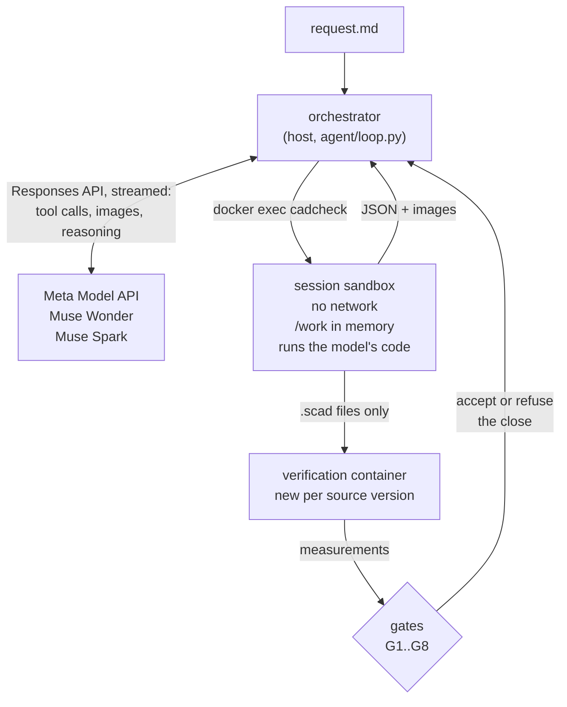

# Architecture

CADVerify is a design loop with two halves that do not trust each other. A Meta model
(`muse-wonder-1.0` by default, or `muse-spark-1.3`, through the Meta Model API) reads the
request, writes OpenSCAD, looks at renders and decides what to change. A deterministic harness
runs every tool, measures every mesh and owns the verdict: the model cannot end a session while
a gate is red.



## The loop

`cadverify.agent.loop.run_session` drives one session. Each iteration is one model request:

1. The model answers with tool calls. The orchestrator runs them in the session sandbox, syncs
   the workspace mirror on the host, and returns each result as JSON (and the image, when the
   tool makes one).
2. After every source change, the harness verifies the current `.scad` files in a fresh
   container and evaluates the gates.
3. A reply without tool calls is a close. The orchestrator accepts it only when every gate is
   green; otherwise the red gates go back to the model with their details.

Before its first edit, a reply without tool calls is a question for the user. It goes out only
after the model has looked at what it was given (the starting source compiled, every part
exported and seen); the user's answer comes back as the next message.

Limits per session: requests, cost and wall time (`cadverify design --max-requests --max-usd
--max-minutes`). About 10 requests before the end the model is told what a close needs; the
last request asks for it. The ledger checks the spend recorded under the results directory
against a total budget before a session starts.

Long sessions are kept alive by:

- streaming every request (a non-streamed request times out at about 600 s on the server, and a
  64k-token response takes longer);
- chaining with `previous_response_id`, while keeping the whole conversation locally: when the
  server loses a stored response, the loop resends the history without it;
- prompt caching (`prompt_cache_key`, 24 h retention), so a long session pays the cached rate
  for most of its input;
- taking old images out of the context once more than 40 are live: each one is replaced by a
  line saying what it showed and the call that shows it again, while the 10 most recent images
  and the last one of every part and of the assembly stay.

## Tools

Twelve tools, all executed by `cadcheck` inside the sandbox (`cadverify.agent.tools`):

| Tool | What it does |
|---|---|
| `scad_write`, `scad_patch` | the only structured way to edit `.scad` files; a patch must match exactly once |
| `scad_compile` | evaluates the program: echoes, warnings, failed asserts, errors |
| `scad_export` | exports a part (`part` selector) to STL with its mesh report and its spec check; a new mesh brings its sheet attached |
| `mesh_report` | watertightness, bad edges and where they are, volume, bounds, bodies |
| `render_sheet` | an orthographic multi-view sheet from our own OpenGL renderer (moderngl on EGL) |
| `render_view` | a view on demand: free camera, zoom, plane cuts with the profile in mm, several parts, highlights (overhangs, support faces, holes, details) |
| `printability_report` | overhangs above 45° by zone in the print orientation, the part of each zone steeper than 60° as a bridge, the bodies that start in the air, and bed fit (Bambu Lab A1, 256 mm cube) |
| `interference_check` | the assembly measured exactly as gates G3 and G4 measure it |
| `run_shell`, `run_python` | the model's own code in `/work`, with a timeout, output truncation and every process killed after the call |
| `view_image` | an image the model made itself (a plot, a custom render) |

Rules enforced by the harness, not asked for in the prompt:

- **Numbers before fixes.** After an image, the sources cannot change until a numeric check has
  run. A visual finding is a hypothesis; it is confirmed with a measurement before it is fixed.
  A `.scad` edited by shell while blocked is undone.
- **The model sees what it makes.** An export with a mesh the model has not seen brings its
  sheet attached, and G7 asks for the sheet of the exact mesh it verifies (matched by SHA-256).
- **Spec moves are flagged.** When the declared spec moves toward what the mesh already
  measured while the mesh stays the same, the tool result says so (`agent/spec_history.py`),
  and the close must tell the user.

## The verifiable spec

OpenSCAD cannot measure geometry, so the source declares its intent and the harness measures
the mesh against it. The declaration is a structured echo computed from the model's own
parameters (`cadcheck/spec.py`):

```openscad
echo(cadverify_spec = [
    ["bounds", [[0, 0, 0], [shelf_length, wall_height, width]]],
    ["bodies", 1],
    ["through_holes", 3],
    ["support_faces", [["wall", "-x", 0.8 * wall_height * width]]],
    ["overhangs_allowed", [["hole roofs", [[95, -1, 0], [105, 7, 50]]]]],
    ["details", [["wall", "thickness", [x, y, z], [dx, dy, dz], 2.4]]]
]);
```

Details are features measured on the mesh (`cadcheck/details.py`): `material` and `void`
fractions of a box, a `hole` profile along an axis, a `thickness` along a ray, and `view` for a
feature no number describes, which the model must look at up close.

An assembly is one more option of the `part` selector. It places each part through a module
the prompt gives the model, so the list of instances comes from the code:

```openscad
cadverify_only = "";
module instance(name, part, unit = 1) {
    echo(cadverify_instance = [name, part, unit]);
    if (cadverify_only == "" || cadverify_only == name) children();
}
```

Its spec declares `allowed_interferences` (press fits, up to 0.3 mm thick), `motions` (a
`rotate` or `slide` swept through its range) and `assembly_order` (each step arrives from far
away along a direction, and may turn, without crossing what is already placed). A press fit is
swept like any other pair, as a fit: along a motion its parts may stay pressed no thicker than
0.3 mm, and on the way in, in each column along the direction, the first of the other part a
part meets must be their overlap in place. The last hinge box of the bridge runs closed green
when G4 still left press-fit pairs out of its sweeps: its catch was declared a press fit, and its
lid came in moving up, through the floor of the box. Two more keys cover what a rigid sweep and
a part-by-part print check cannot:

- a motion's `flex` names a pair of instances that may overlap while it moves, and how deep (up
  to 1 mm): an elastic detent or snap that bends and springs back. The harness measures the
  depth as the farthest a point of the overlap's surface is from the other solid's surface,
  sampled and refined until it is known to stay under the declared value (within 0.05 mm) or
  to pass it, and refuses any overlap at either end of the range;
- `print_in_place` says the product is printed already assembled, with the smallest clearance
  between any two parts (0.2 to 1 mm). G5 then also checks every printed part together against
  the assembly's own `overhangs_allowed`, and every two of them at least that far apart. They
  print as the assembly places them or in its `print_pose`: declared motions at a value of their
  range (a box printed open, its lid's hinge at 180°), with the clearances measured again in
  that pose.

```openscad
["motions", [["lock", ["lid"], "rotate", [0, 0, 0], [0, 0, 1], [-90, 0],
              ["flex", [["lid", "jar", 0.5, "the detent bump rides over the ramp"]]]]]],
["print_in_place", 0.3],
["print_pose", [["hinge", 180]]]
```

### Bridges

A declared overhang is accepted with its reason, but the part of it steeper than 60° from
vertical rests on little of the layer under it, and the A1's slicer supports it by default
(Bambu Studio's threshold angle, 30° to the horizontal,
[Bambu Lab wiki](https://wiki.bambulab.com/en/software/bambu-studio/support)). Without support
it prints as a bridge: in the air from the material under its lowest edge. G5 measures each
connected steep piece, a flat ceiling or a slope, against that material, the mesh's sections
from half a layer (0.1 mm) to 1 mm under its lowest point, which holds it through such a gap
the way a support does: the farthest any point of the piece is from that material, seen from
above. A bridge laid in any direction has to reach that point from both sides, so it spans at
least twice that distance, and G5 refuses more than 10 mm, the longest unsupported bridge in a
quick FDM design guide ([Xometry](https://xometry.pro/en/?p=154421); Protolabs Network gives
about 5 mm without sagging,
[Hubs](https://hubs.com/knowledge-base/how-design-parts-fdm-3d-printing)). A piece with no point
within 0.5 mm of that material starts from nothing and is refused too. The measure is a lower
bound: it does not tell a piece held on one side (a cantilever) from one held on two, and
strips narrower than 0.8 mm are not judged. The top of a round hole passes up to about 20 mm
across, held by the sides of the hole; a lid printed closed over its box does not, its ceiling
held only at the rim.

A body that does not rest on the bed starts printing at its lowest layers, whatever the angle
of its faces. G5 refuses one with nothing under its lowest two layers within 1 mm, the largest
print-in-place clearance: a pin 0.4 mm over the bottom of its bore droops into the clearance
and passes; a lid printed standing, hung from its hinge, starts in the air and does not. The
first Spark box on the bridge check closed green that way, and this check came from it. A later
one stood its lid up again, on a hinge held by a post from the bed, and declared the lid's lower
edge, 80° from vertical and 10 mm out from the hinge, an allowed overhang: G5 then measured
only flat ceilings as bridges, and measures every face steeper than 60° since. On that, the
boxes that printed open fail too: the underside of each hinge knuckle starts in the air, an
island beside the wall that holds it.

## Gates

Judged by the orchestrator on its own verification of the current source, never on the model's
tool results (`agent/gates.py`):

| Gate | Green when |
|---|---|
| G1 | the source compiles and every part exports with no errors, failed asserts or warnings |
| G2 | every part is a closed mesh with the declared number of bodies |
| G3 | the assembly: each instance is its part moved (same volume, area and principal moments), every part present as many times as its `copies`, no overlaps beyond the allowed ones, one connected group, and the units the request chains |
| G4 | every declared motion and the assembly order run without collisions (a press fit only as a fit); a declared flex no deeper than declared and free at both ends of its range |
| G5 | overhangs only inside the allowed boxes (at most half of a part's surface), the part of each steeper than 60° a bridge of 10 mm at most, no body that starts in the air, and every part fits the bed; with `print_in_place`, the same on all the parts together as they print (as placed, or in the `print_pose`), and the declared clearance between any two |
| G7 | the spec holds, details included, and the model saw the final version: the sheet of every part, a view of the whole assembly, a close view of every `view` detail |
| G8 | the close: every `[[name]]` it cites is something the harness verified green, and an auditor (`muse-wonder-1.0` without tools, whatever model designed) finds no claim presented as verified that nothing backs, and no untold spec adjustment |

G6 (fidelity to a reference model) is planned and not part of this build; the numbering keeps
its slot.

### Choosing the auditor

The auditor was chosen by replaying audits, not by assumption
([scripts/audit_replay.py](../scripts/audit_replay.py), records in
[results/bench/](../results/bench/)). Twelve cases:

- the six closes the demo sessions sent to the auditor, three of which it refused;
- six copies of the accepted ones with a known error planted: a strength claim, two numbers
  changed (a height of 86 mm said as 96, a width of 80 as 82), a "does not tip over" nobody
  measured, and two closes with their spec adjustments taken out.

Each case went three times to each model:

| Auditor | Right verdicts | Planted errors caught | Accepted closes refused | USD per audit |
|---|---|---|---|---|
| first summary: `muse-wonder-1.0` | 29 of 36 | 18 of 18 | 7 of 9 | 0.075 |
| first summary: `muse-spark-1.3` | 34 of 36 | 18 of 18 | 0 of 9 | 0.022 |
| current summary: `muse-wonder-1.0` | 33 of 36 | 18 of 18 | 3 of 9 | 0.064 |
| current summary: `muse-spark-1.3` | 36 of 36 | 18 of 18 | 0 of 9 | 0.022 |
| current summary: `muse-spark-1.3-contributor` | 33 of 36 | 18 of 18 | 2 of 9 | 0.001 |

Most of the first summary's refusals were the harness's fault: the auditor was not told what a
green gate had verified, so "0 bad edges" (G2) and "seen up close" (G7) looked unsupported.
The summary now says what each green gate verified, and carries the bad edges and the
printability numbers a close quotes.

With it, Wonder's three remaining refusals are one claim of the hinge box close, refused every
time: "print the default `assembly` output as a single job with no supports". It was right:
G5 did not check a print in place then, and `print_in_place` exists because of it. Spark
accepted that claim every time. All the models caught every planted error, so the difference
is in the subtle claims, and the auditor stays `muse-wonder-1.0` whatever model designs
(`cadverify design --auditor` changes it). The verdicts on the recorded closes are the
author's labels.

## Sandbox

One hardened container per session (`agent/sandbox.py`), from the pinned `cadverify-sandbox`
image (OpenSCAD 2026.10.26 with the Manifold backend, Python 3.12 with trimesh, manifold3d,
numpy, scipy, shapely, matplotlib and Pillow):

- no network; 2 CPUs, 4 GB of memory without swap, 512 processes; no capabilities, no new
  privileges, a read-only root file system;
- `/work` (1 GB) and `/tmp` (512 MB) are tmpfs: filling them never touches the host's disk;
- every exec runs as a user id drawn for the session, so the process limit and the cleanup after
  each call cover exactly the model's processes;
- the orchestrator's prompts, gates and auditor are hidden from the container; the API key never
  enters it;
- the host copies changed files out as a tar stream with the `data` filter, and never executes
  or imports anything from the workspace;
- verification runs in a new container per source version, which receives only the `.scad`
  files; the model cannot reach it.

`cadverify hostile` runs scripted attacks through the same tool box (fork bomb, infinite loop,
disk fill, network, writes outside `/work`, a search for the key, an edit by shell after a
sheet, tampering with the verification, huge output, a memory bomb) and checks that each one is
contained. `tests/test_hostile_docker.py` asserts them.

## Records

Every session writes `results/design/<request>/<UTC>/`:

- `raw/`: every API request and response, with the key never written and images replaced by
  their hash;
- `tools/`: every tool call with its arguments, result, and the files it created, modified or
  deleted;
- `workspace/`: the `.scad` sources, the renders and the images the model saw (STL files are
  regenerated from the sources and not versioned);
- `session.json`: iterations, gates per iteration, tokens, cost and latency, spec adjustments
  and audits.

`cadverify summary <run>` turns a session into a Markdown table, one row per iteration.
